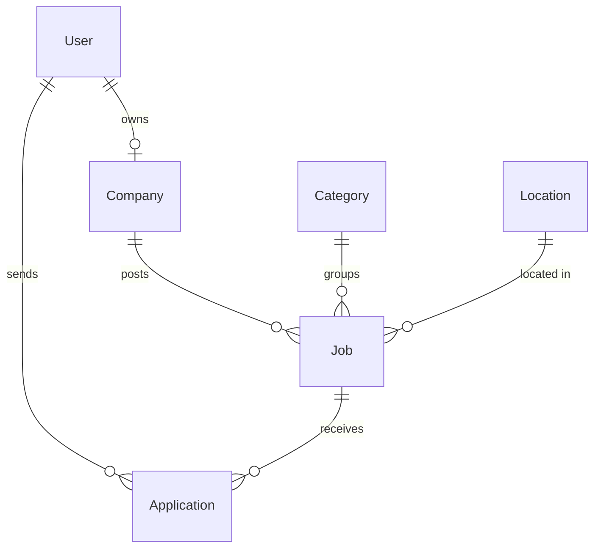

# ZaqaWork

A local job board for a rural district in Azerbaijan — connecting people looking for part-time and full-time work with local employers (shops, restaurants, farms, schools).

> **日本語の概要:** アゼルバイジャンの地方向けの求人サイトです。地元の求職者と雇用主をつなぎ、アルバイト・正社員の求人を検索・掲載できます。アゼルバイジャン語・英語・日本語・ロシア語の4言語に対応しています。

## Why

In small districts, job openings are usually shared in Facebook groups and WhatsApp chats. They get lost quickly, can't be searched, and don't reach people outside those groups. ZaqaWork collects them in one place that is searchable, filterable and works well on a phone.

## Features

**Done**
- Job list with keyword search and filters (job type, category, area), with pagination
- Filters live in the URL, so search results can be shared as links, and the form works without JavaScript
- Job detail page with employer contact info
- 4 languages: Azerbaijani, English, Japanese, Russian. The language is detected from the browser's `Accept-Language` header
- Input validation of query parameters with Zod (invalid values are ignored, never crash the page)
- Mobile-first UI with light/dark mode
- Filter by district (Zaqatala, Balakən, Qax, Şəki) and by village within the district
- Employers post jobs: full-time, part-time, or a **one-day job** with date, start time, duration, number of workers and pay for the whole job or per hour (e.g. "5 hours of yard cleaning on 15 October"). Private persons can post too; the company name is optional
- New jobs wait for **admin approval**; employers see the status on "My jobs". One-day jobs disappear from the list once their start time has passed
- Employers manage their jobs: **edit** (an edited job goes back to admin review), **close** when the worker is found, **reopen** (also reviewed), and **duplicate** an old job as a new one (handy for recurring one-day jobs)
- **Profile** page: name and contacts, business details shown on jobs, password change (logs out other devices)
- **Pay per month, day or hour** for every job type; one-day jobs can also be paid for the whole job
- **Profile photos** for job seekers and employers (an employer's photo is the company logo), and up to **5 optional images per job**, with previews; images are shrunk in the browser and type-checked on the server from their bytes
- **Company location**: an optional address and a point picked on **Google Maps**, shown on the company and job pages (needs `NEXT_PUBLIC_GOOGLE_MAPS_API_KEY`; without it, addresses and "Open in Google Maps" links still work)
- **CVs and online applications**: job seekers upload a CV (PDF, DOC, DOCX; checked from the file's bytes) and apply with an optional message. A CV is required for full-time jobs, optional for part-time and one-day jobs. One application per job; seekers see their status on the job page and under "My applications"
- **Employers review applications**: per job or all together, with the applicant's profile, contacts, message and CV (PDF preview in the page, download for Word), and set the status (New / Reviewed / Accepted / Rejected). New applications are counted in the header
- **Admin panel**: overview (jobs waiting for review, active jobs, one-day jobs today and tomorrow, new users), review queue with an optional rejection reason shown to the employer, all jobs by status with search and "take down", and users with search by name, phone or email and **blocking** (a blocked user is logged out everywhere, cannot log in, and their jobs are hidden)
- Sign up / log in with **email or mobile number** + password. Users pick a role at sign-up (job seeker or employer); browsing needs no account, only applying and posting do. After logging in, users return to the page they came from

**Planned**
- [ ] Employers: see applications
- [ ] Job seekers: profile, apply online, track application status
- [ ] Email notifications
- [ ] Deployment (Vercel + managed PostgreSQL)

## Tech stack

| Area | Choice |
|---|---|
| Framework | Next.js 16 (App Router, Cache Components / Partial Prerendering) |
| Language | TypeScript |
| Database | PostgreSQL + Prisma 7 (driver adapter `@prisma/adapter-pg`) |
| Styling | Tailwind CSS 4 |
| Validation | Zod |
| Testing | Vitest |
| CI | GitHub Actions (lint, typecheck, test, build) |

## Architecture notes

- **i18n without a library.** All routes live under `app/[lang]`. `src/proxy.ts` redirects `/` to the best locale. Translations are plain JSON in `src/i18n/dictionaries`, and each dictionary is typed against the Azerbaijani one, so a missing key is a compile error.
- **Partial prerendering.** The page shell (header, titles, filters' labels) is prerendered at build time per language. Database-driven parts stream in at request time inside `<Suspense>`.
- **Sessions without a library.** Login creates a random token stored in an `httpOnly` cookie; the database keeps only its SHA-256 hash, so a leaked database cannot be used to log in. Logging out deletes the row. Passwords are hashed with bcrypt, and a wrong login returns the same message whether the account exists or not.
- **Phone numbers are normalized** (`050 123 45 67`, `+994 50 123-45-67` → `+994501234567`) before saving and before login, so any common way of writing the number works.
- **Images live in PostgreSQL** (`Image` table, served by `/api/images/[id]` with year-long caching). No extra storage service is needed; all access goes through `src/lib/storage.ts`, so moving to S3/R2 is a one-file change.
- **Private CVs.** CVs are served only by `/api/resumes/[id]`, which checks the session on every request: the owner, admins, and employers the CV was sent to with an application. Everyone else gets 404. A replaced CV is a new record, so employers keep the version they received.
- **Notifications without email (for now).** Each application creates one notification row (unique per application, so a retried submit cannot notify twice), shown to the employer on the site. Email sending is one module, `src/lib/mailer.ts`; until it is configured, notifications are stored with status `NOT_CONFIGURED`, and a mail failure never fails an application.
- **Times are Baku time.** One-day jobs are entered and shown in Azerbaijan time (UTC+4, no daylight saving), stored in UTC, and formatted with an explicit time zone so the server's or browser's zone never shifts them.
- **District-agnostic.** Categories and areas are configured in `src/config/site.ts`, so the same code can serve another district.

### Data model



## Getting started

Requirements: Node.js 22+, PostgreSQL.

```bash
npm install
cp .env.example .env          # set DATABASE_URL
createdb zaqawork
npm run db:migrate            # create tables
npm run db:seed               # demo data
npm run dev                   # http://localhost:3000
```

### Demo accounts

All demo accounts use the password `demo1234`. The job seeker can also log in with the phone number `050 111 00 01`.

| Role | Email |
|---|---|
| Admin | admin@zaqawork.test |
| Employer | market@zaqawork.test |
| Employer | restoran@zaqawork.test |
| Job seeker | seeker@zaqawork.test |

## Scripts

| Command | Description |
|---|---|
| `npm run dev` | Start the dev server |
| `npm run build` | Production build |
| `npm test` | Unit tests |
| `npm run lint` / `npm run typecheck` | Static checks |
| `npm run db:migrate` / `npm run db:seed` | Database migrations / demo data |
