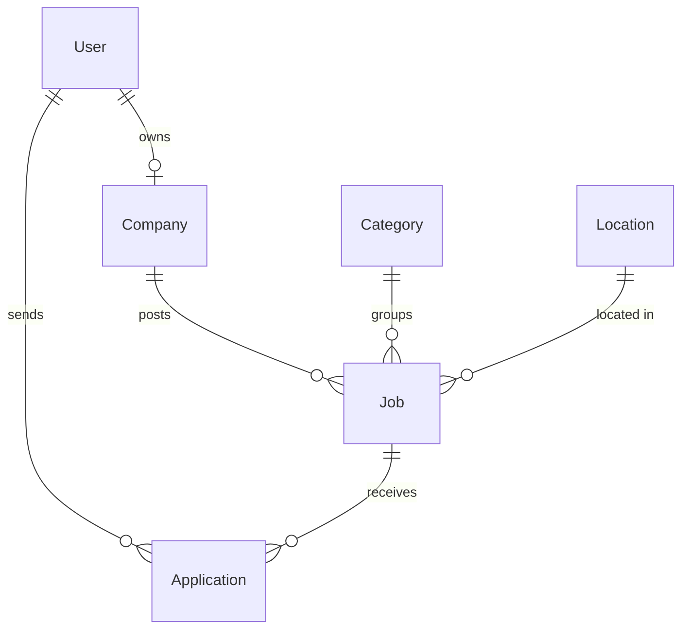

# ZaqaWork

A local job board for a rural district in Azerbaijan — connecting people looking for part-time and full-time work with local employers (shops, restaurants, farms, schools).

> **日本語の概要:** アゼルバイジャンの地方向けの求人サイトです。地元の求職者と雇用主をつなぎ、アルバイト・正社員の求人を検索・掲載できます。アゼルバイジャン語・英語・日本語・ロシア語の4言語に対応しています。

## Why

In small districts, job openings are usually shared in Facebook groups and WhatsApp chats. They get lost quickly, can't be searched, and don't reach people outside those groups. ZaqaWork collects them in one place that is searchable, filterable and works well on a phone.

## Features

**Done**
- Job list with keyword search and filters (job type, category, area), with pagination
- Filters live in the URL, so search results can be shared as links, and the form works without JavaScript
- Job detail page with employer contact info
- 4 languages: Azerbaijani, English, Japanese, Russian. The language is detected from the browser's `Accept-Language` header
- Input validation of query parameters with Zod (invalid values are ignored, never crash the page)
- Mobile-first UI with light/dark mode
- Filter by district (Zaqatala, Balakən, Qax, Şəki) and by village within the district
- Sign up / log in with **email or mobile number** + password. Users pick a role at sign-up (job seeker or employer); browsing needs no account, only applying and posting do. After logging in, users return to the page they came from

**Planned**
- [ ] Employers: post and manage jobs, see applications
- [ ] Job seekers: profile, apply online, track application status
- [ ] Admin moderation of new job posts
- [ ] Email notifications
- [ ] Deployment (Vercel + managed PostgreSQL)

## Tech stack

| Area | Choice |
|---|---|
| Framework | Next.js 16 (App Router, Cache Components / Partial Prerendering) |
| Language | TypeScript |
| Database | PostgreSQL + Prisma 7 (driver adapter `@prisma/adapter-pg`) |
| Styling | Tailwind CSS 4 |
| Validation | Zod |
| Testing | Vitest |
| CI | GitHub Actions (lint, typecheck, test, build) |

## Architecture notes

- **i18n without a library.** All routes live under `app/[lang]`. `src/proxy.ts` redirects `/` to the best locale. Translations are plain JSON in `src/i18n/dictionaries`, and each dictionary is typed against the Azerbaijani one, so a missing key is a compile error.
- **Partial prerendering.** The page shell (header, titles, filters' labels) is prerendered at build time per language. Database-driven parts stream in at request time inside `<Suspense>`.
- **Sessions without a library.** Login creates a random token stored in an `httpOnly` cookie; the database keeps only its SHA-256 hash, so a leaked database cannot be used to log in. Logging out deletes the row. Passwords are hashed with bcrypt, and a wrong login returns the same message whether the account exists or not.
- **Phone numbers are normalized** (`050 123 45 67`, `+994 50 123-45-67` → `+994501234567`) before saving and before login, so any common way of writing the number works.
- **District-agnostic.** Categories and areas are configured in `src/config/site.ts`, so the same code can serve another district.

### Data model



## Getting started

Requirements: Node.js 22+, PostgreSQL.

```bash
npm install
cp .env.example .env          # set DATABASE_URL
createdb zaqawork
npm run db:migrate            # create tables
npm run db:seed               # demo data
npm run dev                   # http://localhost:3000
```

### Demo accounts

All demo accounts use the password `demo1234`. The job seeker can also log in with the phone number `050 111 00 01`.

| Role | Email |
|---|---|
| Admin | admin@zaqawork.test |
| Employer | market@zaqawork.test |
| Employer | restoran@zaqawork.test |
| Job seeker | seeker@zaqawork.test |

## Scripts

| Command | Description |
|---|---|
| `npm run dev` | Start the dev server |
| `npm run build` | Production build |
| `npm test` | Unit tests |
| `npm run lint` / `npm run typecheck` | Static checks |
| `npm run db:migrate` / `npm run db:seed` | Database migrations / demo data |
